#+title: Skapa
#+author: Josep Bigorra
#+email: jjbigorra@gmail.com
#+language: en

[[https://jointhefreeworld.org/ggg/dist/scheme-guile.svg]] [[https://jointhefreeworld.org/ggg/dist/gnu-guix.svg]] [[https://jointhefreeworld.org/ggg/dist/maak.svg]]
[[https://jointhefreeworld.org/ggg/dist/license-agpl3+.svg]]    [[https://jointhefreeworld.org/ggg/dist/license-fdl13+.svg]]

#+attr_html: :width 160 :alt Skapa logo

- 📖 *API reference:* [[https://jointhefreeworld.org/api-docs/skapa/index.html][Skapa API reference]]

Project scaffolding and templating tool with the power of Lisp.  Quick-start your new projects with many of the ready templates.

Empowering you with S-expressions in the (double delta delimited) templates. Actively looking for contributions and community templates.

If you like my work, please support me by [[https://bmc.link/jjbigorra][buying me a cup of coffee ☕]] so I can continue with a lot of motivation.

-------------

** ~ΔΔ ... ΔΔ~ Expressions Inside Template Files
:PROPERTIES:
:CUSTOM_ID: expressions-inside-template-files
:END:

The use of the double greek capital letter delta is for maximum expressiveness, *visibility*, and to avoid any potential conflict with other templating languages.

In any file (e.g., README.md or config.json):

#+begin_src markdown
# ΔΔ project-name ΔΔ

Framework: ΔΔ framework ΔΔ

ΔΔ (if include-db "## Database Setup\nConfigured for PostgreSQL." "## Database\nNo database selected.") ΔΔ

## License
ΔΔ license-body ΔΔ
#+end_src

-----------------

~skapa~ is designed to be interactive and simple to use and features a helpful wizard, with usage memory and sane defaults.

Simply run the command to start the interactive scaffolding wizard:

#+BEGIN_SRC sh
skapa
#+END_SRC

The wizard will guide you through:

1. Choosing a project template from the available resources.
2. Answering specific questions defined by that template (e.g., project name, license, features to include).
3. Generating the final project structure in a new directory based on your project name.

----------------------

You can see all available options by running:

#+BEGIN_SRC sh
skapa --help
#+END_SRC

Example of common options (if implemented in the template valg):

#+BEGIN_SRC sh
skapa --template web-app --output my-new-app --project-name "My Awesome App"
#+END_SRC

---------

* How It Works
:PROPERTIES:
:CUSTOM_ID: how-it-works
:END:

~skapa~ is written entirely in [[https://www.gnu.org/software/guile][GNU Guile Scheme]]. It processes project templates using a powerful combining of flat-file copying and expressive Scheme evaluation.

Templates reside in the ~resources/templates/~ directory of the distribution (or your local Guix profile data directory). A ~skapa~ template consists of:

1. **A ~contents/~ directory:** Contains the static and dynamic files of the template.
2. **A ~valg.scm~ file:** A Guile Scheme association list defining the template's metadata and interactive prompts.

Files inside the ~contents/~ directory can contain *$\Delta\Delta$ Expressions*. When running the wizard, ~skapa~ captures your answers, evaluates any Scheme code inside these expressions, and writes the transformed result to your new project directory.

That walk, drawn:

#+attr_html: :width 760 :alt Skapa's template engine: the wizard's answers and the project memory form a context, and the template directory is walked into the generated project

The diagram is generated from
[[file:resources/diagrams/template-engine.mmd][resources/diagrams/template-engine.mmd]]
by ~maak diagrams~.  The same diagram sits in the ~;;; Commentary:~ block of
=(skapa engine)=, so it also reaches the API reference.

-------

* Existing templates
:PROPERTIES:
:CUSTOM_ID: existing-templates
:END:

See [[file:resources/templates/][the ./resources/templates directory]] for more information about all the existing templates.

We have, among others simple READMEs, Kotlin Spring Boot, ZIO HTTP, Guile Scheme CLI.

* Community Templates
:PROPERTIES:
:CUSTOM_ID: community-templates
:END:

~skapa~ wants your templates! 🖐🏼

If you have a workflow or project structure that you repeatedly use, consider contributing it as a template to the project.

 How to Contribute a Template?

1. Look at the existing templates in ~resources/templates/~.
2. Create a new directory following the same structure (~contents/~ + ~valg.scm~).
3. Use ~ΔΔ ... ΔΔ~ in your content files to make them dynamic. Remember you have the full power of Lisp at your disposal there.
4.  Fine-tune your ~valg.scm~ declaration.
5. Open a pull request!

--------------

Example Template Valg in Action, drop a new template folder with its own valg.scm:

~resources/templates/web-app/valg.scm~

#+begin_src scheme
((name . "Fullstack Web App")
  (prompts . (((key . project-name)
               (prompt . "Project name")
               (type . string)
               (default . "my-web-app"))

              ((key . framework)
               (prompt . "Frontend Framework")
               (type . choice)
               (choices . ("vue" "react" "htmx"))
               (default . "htmx"))

              ((key . include-db)
               (prompt . "Include PostgreSQL configuration?")
               (type . boolean)
               (default . #t)))))
#+end_src

--------------

#+begin_quote
Delightfully dynamic project scaffolding in the Scheme-powered project initializer.

Expressive templates. Pure creation, so why stop at variables when your templates can think in Scheme and *forge a new project* from a tempate powerfully
#+end_quote

[[https://jointhefreeworld.org/static-assets/skapa/skapa-small.png]]

--------

* Ways to install
:PROPERTIES:
:CUSTOM_ID: ways-to-install
:END:

/Four routes to the same 0.0.4, from the most automated to the most manual.  They all build the tag this README documents./

** From the Guix channel
:PROPERTIES:
:CUSTOM_ID: from-the-guix-channel
:END:
*GNU Guix* is the functional package manager this project is developed with: a build is a pure function of its inputs, so the same recipe gives the same result everywhere, and an upgrade that goes wrong can be rolled back.

The jointhefreeworld channel carries ~skapa~ at 0.0.4, so a checkout of the channel is enough — no package definition to write:

#+begin_src shell
git clone https://codeberg.org/jjba23/guix-jointhefreeworld.git
guix install -L ./guix-jointhefreeworld skapa
#+end_src

Add the channel to ~$HOME/.config/guix/channels.scm~ (the channel's README has the four lines) and a plain ~guix install skapa~ keeps working on every later ~guix pull~.

** From the Nix flake
:PROPERTIES:
:CUSTOM_ID: from-the-nix-flake
:END:
*Nix* offers the same declarative, reproducible model with its own language, its own store and a binary cache, and it is a natural fit if the rest of your machine is already described in Nix.

This project is not in the flake yet; the flake builds the projects that carry a Nix expression of their own.

** As a container image
:PROPERTIES:
:CUSTOM_ID: as-a-container-image
:END:
*Podman or Docker* is the route that puts nothing on the host: the ~Dockerfile~ in this repository builds the project in a builder stage and copies only what it installed into a runtime stage, so the image is small and the host keeps its own toolchain untouched.

#+begin_src shell
podman build -t skapa .   # docker build -t skapa . also works
podman run --rm -it skapa
#+end_src

The image's entry point is Guile, with skapa on its load path, which makes it useful for a quick try and for reproducing a bug on a clean system.

** As a distribution package
:PROPERTIES:
:CUSTOM_ID: as-a-distribution-package
:END:
*Debian, openSUSE and Arch* each get the project through their own package manager.  Packaging lives in this repository under ~packaging/~ and is pinned to the same release tag, so the recipes and the sources they build are versioned together.

None of the three archives ships skapa yet, so these are recipes to build rather than packages to install from a mirror:

| Distribution   | Package | How to build it                                                                     |
|----------------+---------+-------------------------------------------------------------------------------------|
| Debian, Ubuntu | ~skapa~ | copy ~packaging/debian~ to the repository root, then ~dpkg-buildpackage -us -uc -b~ |
| openSUSE       | ~skapa~ | ~osc build~ with ~packaging/opensuse~                                               |
| Arch           | ~skapa~ | ~makepkg -si~ in ~packaging/arch~                                                   |

Each recipe carries its own dependency list, so a missing library fails the build with its name rather than producing a package that cannot load.

** Which one?
:PROPERTIES:
:CUSTOM_ID: which-one
:END:
- *Guix* if you want the toolchain the project is tested with, and the ability to roll back a bad upgrade.
- *Nix* if the rest of your machine is already declarative; this flake does not carry the project yet, but the container image and the recipes below do.
- *Container* if you only want to try the release, or reproduce a report on a machine that has nothing installed.
- *Distribution package* if you want the project managed by the same tool as the rest of your system, with its licence, manual page and launcher in the usual places.

* Installing
:PROPERTIES:
:CUSTOM_ID: installing
:END:

/Feel free to use it as you wish, within the terms of the GNU General Public License v3 or newer./

** On Guix
:PROPERTIES:
:CUSTOM_ID: on-guix
:END:

Requirements:
- *Guix*: The Guix package manager will ensure a reproducible working software, and will manage all needed dependencies for you.
-  *Guile Scheme:*  This entire program is written using the official GNU extension language, Guile Scheme.

If you just want to quickly install it to your profile, use the channels this
project pins -- the jointhefreeworld channel carries the scriba release
~guix.scm~ builds against, so the time-machine form always works:

#+begin_src shell
guix time-machine --channels=channels.scm -- package --install-from-file=./guix.scm
#+end_src

With the jointhefreeworld channel in ~$HOME/.config/guix/channels.scm~, the
plain form works too:

#+begin_src shell
guix package --install-from-file=./guix.scm
#+end_src

For example, to enter an environment shell with skapa temporarily you can use:
#+begin_src shell
guix time-machine --channels=channels.scm -- shell -f guix.scm
#+end_src

You can also chain commands to it:

#+begin_src shell
guix time-machine --channels=channels.scm -- \
     shell -f guix.scm -- \
     skapa --help
#+end_src

You can also run a dev shell (with manifest)
#+begin_src shell
guix time-machine --channels=channels.scm -- \
     shell -m manifest.scm -- guile -L ./src -c \
     '((@(skapa main) main))' --list
#+end_src

Skapa is available in upstream Guix as ~skapa~ in the module ~(gnu packages build-tools)~

** [TODO] On Podman/Docker
:PROPERTIES:
:CUSTOM_ID: todo-on-podmandocker
:END:

Skapa is also available as a Docker container, from DockerHub (also compatible with Podman).

https://hub.docker.com/repository/docker/jjba23/skapa/general

You can also build images of skapa yourself, using ~guix pack~. See the ~maak.scm~ file for more.
To load these tarball images, you can do ~podman load < my.tar.gz~

Then you can run Skapa from the container, and bind your local filesystem to give access, for example:

#+begin_src shell
 docker container run -v /home/joe:/home/joe \
     docker.io/jjba23/skapa:latest \
     skapa -f /home/joe/hacking/skapa/skapa.scm --list
#+end_src

** On Nix
:PROPERTIES:
:CUSTOM_ID: on-nix
:END:

~skapa~ also is packaged via Nix.

#+begin_src shell
# Building via legacy Nix
nix-build default.nix

# Testing the result
./result/bin/skapa --help

# Building via Nix Flakes
nix build
./result/bin/skapa --list
#+end_src

--------------

* Licensing
:PROPERTIES:
:CUSTOM_ID: licensing
:END:

skapa and all of its source code are free software, licensed under the GNU Affero General Public License v3 (or newer at your convenience).

https://www.gnu.org/licenses/agpl-3.0.html

The documentation and examples, including this document, which are provided with skapa, are all licensed under the GNU Free Documentation License v1.3 (or newer at your convenience).

https://www.gnu.org/licenses/fdl-1.3.html

----------------------

* AI Policy
:PROPERTIES:
:CUSTOM_ID: ai-policy
:END:

This project follows the [[https://jointhefreeworld.org/ai-policy/][jointhefreeworld AI policy]].
[[file:AI_POLICY.md][AI_POLICY.md]] holds the short version; the full policy is the link above.

----------

* Code of conduct
:PROPERTIES:
:CUSTOM_ID: code-of-conduct
:END:

This project adheres to the jointhefreeworld code of conduct. Find it here:

https://jointhefreeworld.org/blog/articles/personal/jointhefreeworld-code-of-conduct/index.html

In summary, we foster an inclusive, respectful, and cooperative environment for all contributors and users of this free software project. Inspired by the ideals of the GNU Project, we strive to uphold freedom, equality, and community as guiding principles. We believe that collaboration in a community of mutual respect is essential to creating excellent free software.

---------

* Automation with Maak 🛠️
:PROPERTIES:
:CUSTOM_ID: automation-with-maak
:END:

This project uses [[https://codeberg.org/jjba23/maak][Maak]] for build automation, developer tooling, and task orchestration.

#+begin_quote
Most build systems invent their own limited, arcane domain-specific language (DSL). *Maak* embraces the full power of *λ Lisp* (GNU Guile Scheme), providing an infinitely extensible control plane where every task is a first-class Scheme function.
#+end_quote

[[https://jointhefreeworld.org/ggg/dist/maak.svg]]

** Why Maak?
:PROPERTIES:
:CUSTOM_ID: why-maak
:END:

- *Power of Lisp λ*: Define tasks, build steps, data pipelines, or complex macros using real Lisp (Guile Scheme) without so much copy-pasting, no weird =.PHONY= rules, and no restrictive YAML syntax.
- *Transparent Execution*: Built-in helpers like =$=, =log-info=, and =parameterize= make running shell commands and dry-runs clean and predictable.
- *Guix & Nix Integration*: Native support for reproducible development environments via =manifest-shell=, =program-shell=, and time-machine integration.

Project automation logic lives inside =./maak.scm=. Feel free to inspect, extend, or hack on it!

Learn more about Maak and how to use it and install it on your system at [[https://codeberg.org/jjba23/maak][Codeberg: jjba23/maak]].

----------

* On Reproducibility: Why GNU Guix?
:PROPERTIES:
:CUSTOM_ID: on-reproducibility-why-gnu-guix
:END:

A build should never fail because "it worked on my machine." Reliable software development requires explicit, bit-for-bit reproducibility and a functional approach to package management and system deployment.

#+BEGIN_EXPORT html

#+END_EXPORT

- *Declarative Build Graphs:* Packages are pure functions of their inputs with no implicit system state.
- *Programmable with Guile:* Full system and package configurations written in [[https://www.gnu.org/software/guile/][Guile Scheme]] rather than rigid DSLs or static files.
- *Time Travel:* Rebuild the exact system state from any point in git history using ~guix time-machine~.
- *Atomic Operations:* Instantly upgrade or roll back environments without leaving orphaned dependencies or broken states.
- *Unified Tooling:* One tool manages development shells, isolated containers, package builds, and full system configurations.

--------------

** Hacking around
:PROPERTIES:
:CUSTOM_ID: hacking-around
:END:

#+begin_src shell
cd ../../ && maak run && cd  dist/kkk && chmod +x gradlew && just test
cd ../../ && maak run && cd  dist/kkk && chmod +x gradlew && just run
#+end_src

------------------
